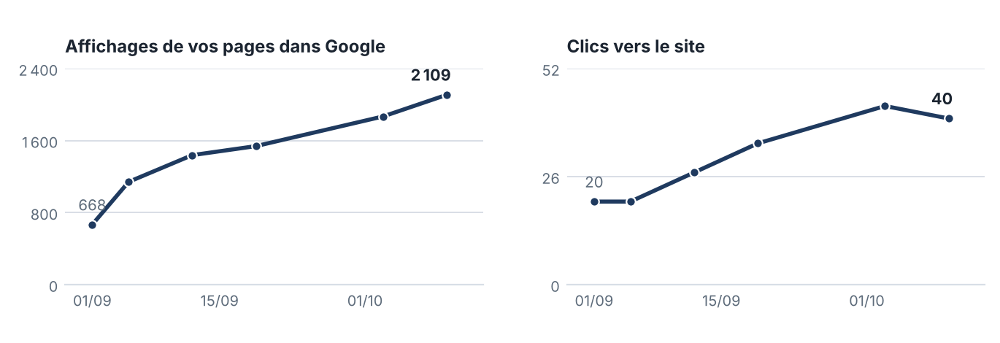

| | |
|---|---|
| **Client** | Transports Ansquer |
| **Période** | 2026-09 |
| **Généré le** | 2026-10-15 (session interactive claude.ai — la tâche planifiée du 01/10 n'a pas tourné, cf. to-do #20 ; retard de 14 jours assumé et non reproduit : le circuit de production des rapports migre vers les tâches cloud) |
| **Statut** | 📤 **émis le 15/10/2026 à 11h28** (envoyé par l'opérateur depuis axel@kaelix.fr → contact@transportsansquer.fr, cc mickael@kaelix.fr, PDF final en PJ — vérifié dans les messages envoyés). **Fichier FIGÉ** (md + PDF) : toute correction = nouveau fichier daté. Historique : ✅ validé le 15/10 (gate claude.ai : « vraiment bien ») ; ajouts pré-émission le 15/10 sur demandes opérateur — tableau « Là où vous êtes le mieux placé » (3 requêtes, fenêtre S41), graphique d'évolution (6 fenêtres GSC 28 j : rapport d'août + S37→S42), logo KÆLIX + croix en filigrane (planche logo du 15/10) |
| **Sources** | Search Console API directe — fenêtres relevées aux revues S37→S42 (28 j « septembre » = 06/09→03/10, comparée à 28 j « août » = 05/08→01/09, même outil, invariant 8) ; Haloscan (positions, revues hebdo) ; tracking.md ; content-plan.md ; journal du brief |
| **Points à confirmer avant validation** | Aucun côté client. ⚠️ interne : avis GBP **non relevés depuis le 04/09** (fiche hors de portée des outils — dernier relevé : 1 avis, gilles, 4/5) → la section ④ reste générique, aucune affirmation sur les avis ; la réponse à l'avis gilles (GO du 04/09) n'est toujours pas publiée (to-do #12) — le rapport n'en parle pas |

<!-- CLIENT -->

# Votre visibilité en ligne : septembre 2026

Transports Ansquer · rapport mensuel KAELIX · période du 1er au 30 septembre 2026

## ① Ce qui a été fait ce mois

Septembre a été le mois du passage en rythme de croisière : deux nouveaux articles publiés (quatre au total sur le blog), la mesure branchée en direct sur Google, et votre premier mois de chiffres réels. Tout ce qui suit est en ligne et vérifiable.

| Réalisation | Date | Où le voir |
|---|---|---|
| Article : **transport dédié, messagerie ou coursier ponctuel** — le comparatif pour choisir le bon modèle de livraison | 2 sept. | [lire l'article](https://transportsansquer.fr/blog/transport-dedie-messagerie-ou-coursier/) |
| Article : **combien de palettes dans un conteneur ?** — la table complète 20'/40'/40'HC (80×120 et 100×120, limites de poids) | 14 sept. | [lire l'article](https://transportsansquer.fr/blog/combien-de-palettes-dans-un-conteneur/) |
| Mesure branchée **en direct sur Google Search Console** : positions, affichages et clics relevés chaque semaine, sans intermédiaire | 3 sept. | outil de mesure (interne) |
| Rapport d'août transmis | 3 sept. | votre boîte mail |
| Annuaires : état des lieux complet (Pages Jaunes, 118000, Mappy) et fiches préparées — mise en ligne en cours | 4 sept. | — |
| Surveillance hebdomadaire automatisée : positions, prise en compte par Google et santé du site relevées chaque lundi matin | depuis le 7 sept. | — |

L'article « combien de palettes » publie la table de chargement que personne d'autre ne donne correctement (les deux formats de palettes, le gerbage, les limites de poids) : c'est lui qui tire votre visibilité ce mois-ci.

## ② Ce que ça donne : vos premiers chiffres

**Les premiers chiffres réels sont là, et ils vont dans le bon sens.** Sur un mois complet, comparé au mois précédent (mêmes mesures Google, mêmes fenêtres de 28 jours) :

| Indicateur | Août | Septembre | Évolution |
|---|---|---|---|
| Affichages de vos pages dans Google | 668 | 1 869 | **×2,8** |
| Clics vers le site | 20 | 43 | **×2,2** |

<em>Chaque point est le total des 28 derniers jours à la date du relevé (mesure Google Search Console, relevé chaque lundi ; pas de relevé le 28/09).</em>

### Là où vous êtes le mieux placé

Trois recherches que vous pouvez taper vous-même dans Google :

| Recherche | Votre position | Ce qui s'affiche |
|---|---|---|
| « transport ansquer » | **1re** | votre page d'accueil |
| « nombre de palettes dans un container 40 pieds » | **3e-4e** | votre article palettes |
| « crossdocking île de france » | **top 5** | votre page entrepôt de Gennevilliers |

<em>Positions moyennes Google sur le mois : elles peuvent varier légèrement d'une recherche à l'autre.</em>

- **L'article « combien de palettes » est votre contenu le plus vu** : pris en compte par Google en 3 jours, il tourne autour de la 6e-7e position sur ses recherches et représente déjà plus d'un cinquième des affichages du site — et sa courbe continue de monter début octobre.
- **Votre page d'accueil sur « transporteur Gennevilliers »** se tient autour de la 7e à 9e position, avec sa meilleure semaine depuis le nouveau site début octobre. Le site est encore dans sa période d'évaluation par Google (jusqu'à fin octobre) : on observe, on ne retouche rien.
- **Un point de vigilance, en toute transparence** : deux articles (le guide conteneurs et le comparatif) ne sont pas encore pris en compte par Google. L'anomalie a été identifiée (une entrée erronée dans le plan du site transmis à Google) et sera corrigée dans les prochains jours. Les clics restent par ailleurs modestes : c'est l'ordre normal des choses — la visibilité monte d'abord, les clics suivent.

## ③ Ce qui arrive

- **Fin octobre** : fin de la période d'évaluation Google du nouveau site → premier bilan stable des 16 pages de services, et le calendrier de contenus recalé en conséquence.
- **Novembre** : les premières optimisations ciblées sur l'existant (page d'accueil, page course urgente) — le levier le plus rentable, une fois la période de test terminée.
- Le prochain article : **« Commissionnaire de transport ou transporteur : qui mandater ? »** — la question que se posent vos clients importateurs.
- Le déblocage de la prise en compte des deux articles, et la mise en ligne des fiches annuaires (Pages Jaunes, 118000, Mappy).

## ④ Ce dont nous avons besoin de votre côté

Votre lien pour recueillir des avis Google : **https://g.page/r/CSTJAaXNYqRfEBM/review** — à transmettre quand l'occasion se présente à un client satisfait. Chaque avis renforce directement votre visibilité locale. C'est tout : le reste roule sans vous.
